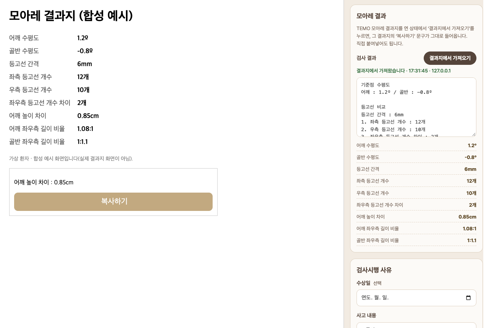
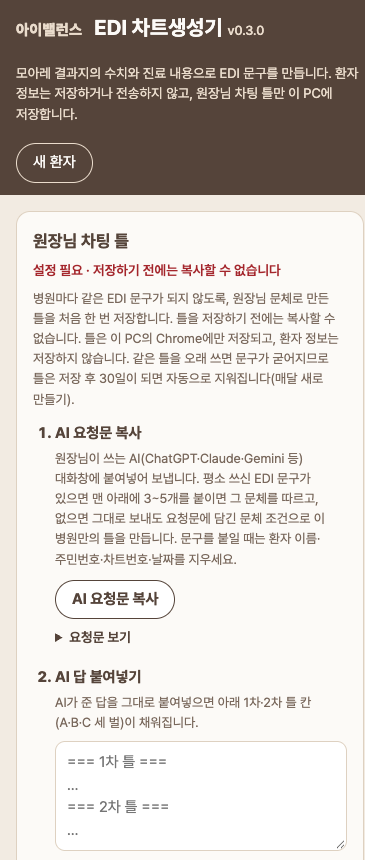
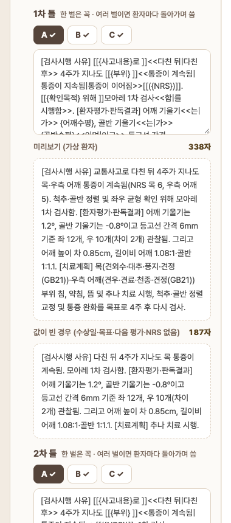
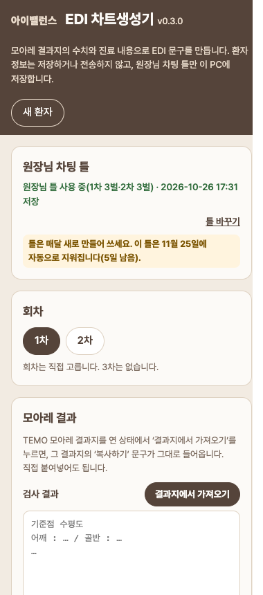
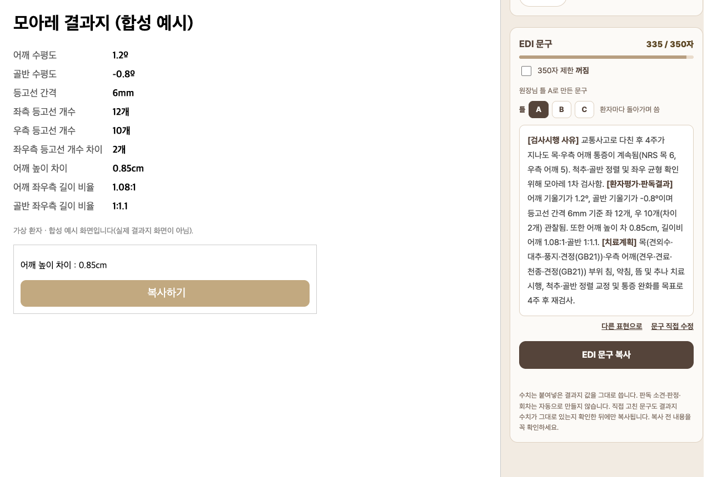

<p align="center"></p>

<h1 align="center">EDI 딸깍</h1>

<p align="center"><b>아이밸런스 모아레 결과지로 자동차보험 EDI 특정내역 문구를 만드는 크롬 확장 프로그램</b><br>크롬에는 <b>아이밸런스 EDI 차트생성기</b>라는 이름으로 설치됩니다.</p>

<p align="center">현재 버전 <b>v0.3.0</b> · <a href="CHANGELOG.md">변경 이력</a> · <a href="../../releases">다운로드(Releases)</a></p>

---

## 개발 이유

자동차보험 환자에게 모아레 검사를 하면 EDI에 **검사시행 사유, 환자평가·판독결과, 치료계획**(2차는 치료 후 평가)을 적어야 합니다. 결과지의 수치 9개를 옮겨 적고 문장을 다듬는 일을 환자마다 반복하면 시간이 들고, 수치를 잘못 옮기기도 쉽습니다.

EDI 딸깍은 결과지 옆에서 수치를 그대로 가져와, 클릭 몇 번으로 문구를 만듭니다. 모든 한의원이 똑같은 문구로 청구하면 문제가 될 수 있어, **원장님 문체로 만든 차팅 틀**을 먼저 저장해야 쓸 수 있게 했습니다.

## 목차

1. [이 프로그램은 무엇인가요?](#1-이-프로그램은-무엇인가요)
2. [현재 버전(v0.3.0) 안내](#2-현재-버전v030-안내)
3. [준비물](#3-준비물)
4. [크롬 확장 프로그램 설치 방법](#4-크롬-확장-프로그램-설치-방법)
5. [처음 한 번: 원장님 차팅 틀 만들기](#5-처음-한-번-원장님-차팅-틀-만들기)
6. [사용 방법](#6-사용-방법)
7. [문제가 생겼을 때](#7-문제가-생겼을-때)
8. [새 버전으로 업데이트하기](#8-새-버전으로-업데이트하기)
9. [안전과 개인정보](#9-안전과-개인정보)
10. [확인한 범위와 한계](#10-확인한-범위와-한계)
11. [개발자용 안내](#11-개발자용-안내)

---

## 1. 이 프로그램은 무엇인가요?

TEMO(아이밸런스) 모아레 결과지를 연 상태에서 툴바 아이콘을 누르면, **오른쪽 사이드 패널**에 EDI 차트생성기가 열립니다. 새 탭이나 새 페이지로 넘어가지 않고, 보던 결과지 옆에 붙어 나옵니다.



<sub>왼쪽이 결과지, 오른쪽이 사이드 패널입니다. 그림의 결과지는 합성 예시 화면이고, 값은 가상 환자 값입니다.</sub>

- **결과지에서 가져오기**를 누르면, 결과지의 **‘복사하기’ 버튼이 만드는 문구를 그대로** 가져와 수치 9개를 읽습니다. 수치를 다시 계산하지 않습니다.
- 통증 부위·NRS·혈자리·치료를 클릭으로 고르면, 원장님 차팅 틀에 맞춰 EDI 문구가 만들어집니다.
- **EDI 문구 복사**를 누른 뒤 EDI 프로그램에 붙여넣습니다.

> 결과지 수치는 결과지 문구 그대로 씁니다. 판독 소견·판정·회차는 자동으로 만들지 않습니다. **복사하기 전에 문구를 꼭 확인하세요.**

## 2. 현재 버전(v0.3.0) 안내

**v0.3.0 (2026-11-20)** — 원장님 차팅 틀을 처음 한 번 저장해야 쓸 수 있습니다. 틀은 원장님이 쓰는 AI로 만들고, 30일마다 새로 만듭니다.

| 기능 | 설명 |
|---|---|
| 결과지에서 가져오기 | 결과지의 ‘복사하기’ 문구를 그대로 가져와 수치 9개를 읽음. 결과지 탭에서 아이콘을 다시 누르지 않아도 되고, 처음 쓰는 주소만 한 번 허용 |
| 1차·2차 | 2차는 1차·2차 결과지를 각각 가져와 수치 변화를 비교해 씀 |
| 원장님 차팅 틀 | AI 요청문을 원장님 AI에 보내고, 답을 붙여넣어 저장. 평소 EDI 문구 예시가 없어도 됨 |
| 틀 3벌 돌려쓰기 | 1차·2차 틀을 A·B·C 세 벌씩 저장하고 환자마다 돌아가며 씀 |
| 바꿔 쓸 말 | 틀 안의 `<<그리고\|또한\|아울러>>` 같은 후보 가운데 하나를 환자마다 골라 씀. ‘다른 표현으로’로 다시 고름 |
| 30일 틀 | 저장 후 30일이 되면 틀을 지움(매달 새로 만들기). 남은 날짜를 늘 보여 주고 마지막 7일은 경고 |
| 수치 보호 | 문구를 직접 고쳐도 결과지 수치가 빠지거나, 바뀌거나, 더 들어가거나, 순서가 바뀌면 복사를 막음 |
| 350자 안내 | 350자를 넘으면 경고만 하고 복사는 됨. ‘350자 제한’을 켜면 넘을 때 막음 |

## 3. 준비물

- 크롬(Chrome) 121 이상
- TEMO(아이밸런스) 모아레 결과지를 볼 수 있는 PC
- 원장님이 쓰는 AI(ChatGPT·Claude·Gemini 등): 처음 틀을 만들 때와 30일마다 한 번
- EDI 프로그램

## 4. 크롬 확장 프로그램 설치 방법

> 크롬 웹스토어에 등록하지 않은 버전이라 **개발자 모드**로 설치합니다. 처음 한 번만 하면 됩니다.

### 4-1. 파일 받기

1. 이 페이지 오른쪽의 **[Releases](../../releases)** 를 누릅니다.
2. 최신 버전의 **`edi-ttalkkak-v0.3.0.zip`** 을 내려받습니다.
3. 내려받은 ZIP 파일을 **더블클릭해서 압축을 풉니다.** `edi-ttalkkak-v0.3.0` 폴더가 생깁니다.
4. 이 폴더를 지우지 않을 위치(예: `문서` 폴더)로 옮겨 둡니다.
   크롬은 이 폴더에서 프로그램을 읽기 때문에, **폴더를 지우거나 옮기면 확장 프로그램이 동작하지 않습니다.**

### 4-2. 개발자 모드 켜기

1. 크롬 주소창에 `chrome://extensions` 를 입력하고 Enter를 누릅니다.
2. 오른쪽 위의 **개발자 모드** 스위치를 켭니다.

### 4-3. 압축 푼 폴더 불러오기

1. 왼쪽 위의 **압축해제된 확장 프로그램을 로드합니다**를 누릅니다.
2. 4-1에서 압축을 푼 **`edi-ttalkkak-v0.3.0` 폴더**를 선택합니다. 폴더 안에 `manifest.json` 파일이 바로 보이는 폴더여야 합니다.

> **Windows에서 "매니페스트 파일이 없거나 읽을 수 없습니다"가 나올 때**
> Windows의 압축 풀기는 같은 이름의 폴더를 한 번 더 만듭니다. 폴더를 한 번 더 들어가서 `manifest.json`이 바로 보이는 **안쪽** 폴더를 선택하세요.
>
> ```
> 다운로드\edi-ttalkkak-v0.3.0\            ← 이 폴더가 아니라
>     └ edi-ttalkkak-v0.3.0\             ← 이 폴더를 선택
>           ├ manifest.json
>           └ sidepanel.html …
> ```

**아이밸런스 EDI 차트생성기 0.3.0** 카드가 보이고 스위치가 켜져 있으면 설치가 끝났습니다.

### 4-4. 툴바에 고정하기 (권장)

크롬 오른쪽 위의 **퍼즐 모양 아이콘**을 누르고, **아이밸런스 EDI 차트생성기** 옆의 **핀**을 누릅니다. 다음부터는 이 아이콘만 누르면 패널이 열립니다.

## 5. 처음 한 번: 원장님 차팅 틀 만들기

틀을 저장하기 전에는 문구를 복사할 수 없습니다(미리보기만 보입니다).

<p align="center"></p>

1. 패널 맨 위 **원장님 차팅 틀**에서 **AI 요청문 복사**를 누릅니다.
2. 원장님이 쓰는 AI 대화창에 붙여넣어 보냅니다.
   - 평소 쓰신 EDI 문구가 있으면 맨 아래에 3~5개를 붙입니다. AI가 그 문체를 따릅니다.
   - 없으면 그대로 보내도 됩니다. 요청문에 담긴 **문체 조건**으로 이 병원만의 틀을 만듭니다. 조건은 패널을 열 때마다 달라집니다.
   - 문구를 붙일 때는 **환자 이름·주민번호·차트번호·날짜를 지우세요.**
3. AI 답을 그대로 **AI 답 붙여넣기** 칸에 붙여넣습니다. 1차·2차 틀 칸이 **A·B·C 세 벌씩** 채워집니다.
4. 칸 위 **A·B·C** 단추로 벌마다 가상 환자 미리보기(값이 다 찬 경우, 값이 빈 경우)를 확인합니다. 빨간 항목이 있으면 틀을 고칩니다.
5. **틀 저장**을 누릅니다. 카드가 ‘원장님 틀 사용 중’으로 바뀝니다. 바꾸려면 **틀 바꾸기**를 누릅니다.

<p align="center"></p>

**틀을 저장할 때 검사하는 것**

- 결과지 수치는 숫자로 적지 않고 `{어깨수평}` 같은 변수로만 씁니다.
- `{NRS}`가 있어야 합니다(통증 점수 누락은 삭감 사유가 될 수 있습니다). 2차 틀에는 `{소견}`·`{판정}`도 있어야 합니다.
- ‘현저히·다소·약간’처럼 정도를 판단하는 말은 틀에 쓸 수 없습니다. 환자마다 다른 판단은 판정·소견으로만 들어갑니다.
- 바꿔 쓸 말 `<<후보|후보>>`의 후보에는 한글·띄어쓰기·쉼표·가운뎃점만 쓸 수 있습니다.
- 요청문의 형식 예시를 거의 그대로 쓰면 저장되지 않습니다(병원마다 같은 문구가 되지 않게).

**30일 규칙** — 틀은 이 PC의 크롬에만 저장되고, **저장 후 30일이 되면 자동으로 지워집니다.** 같은 틀을 오래 쓰면 문구가 굳어지기 때문입니다. 틀 카드에 지워지는 날과 남은 날짜가 늘 보이고, 마지막 7일은 노란색으로 알려 줍니다. 같은 틀을 다시 저장해도 기간은 늘지 않습니다. 새로 만들 때는 **AI 요청문 복사**부터 다시 합니다.

<p align="center"></p>

## 6. 사용 방법

### 6-1. 결과지 열기

TEMO에서 환자의 **모아레 결과지**(수치와 ‘복사하기’ 버튼이 보이는 화면)를 엽니다.

### 6-2. 결과지에서 가져오기

1. 툴바 아이콘을 눌러 패널을 엽니다.
2. 회차(1차·2차)를 고르고 **결과지에서 가져오기**를 누릅니다.
3. **처음 쓰는 주소**에서는 크롬이 접근 허용을 묻습니다. **허용**을 누릅니다.

- 2차라면 1차 결과지를 열고 1차 칸의 가져오기를, 2차 결과지를 열고 2차 칸의 가져오기를 누릅니다.
- 패널을 열어 둔 채 로그인하거나 다른 환자 결과지로 옮겨도 아이콘을 다시 누를 필요는 없습니다.
- 가져올 때 결과지에 잠깐 "복사되었습니다."가 뜨는 것은 뷰어 자체 표시입니다. 클립보드는 쓰지 않습니다.

### 6-3. 진료 내용 고르기

- **1차:** 수상일, 사고 내용, 통증 부위(목·어깨·허리·무릎·기타)와 좌우·NRS, 혈자리, 확인 목적, 치료(침·약침·뜸·추나), 치료 목표, 다음 평가 시점
- **2차:** 위 항목에 더해 1차 검사일, 1차 이후 받은 치료, 판독 소견, 판정(호전·유지·악화), 치료 지속/종료

혈자리는 부위마다 초기값이 선택되어 있습니다. 실제 시술한 혈자리만 남기고, 없는 것은 직접 적습니다.

### 6-4. 문구 확인과 복사

**EDI 문구 복사**를 누른 뒤 EDI 프로그램에 붙여넣습니다.



- 틀을 여러 벌 저장했다면 환자마다 **A→B→C** 순서로 돌아가며 씁니다. 틀을 저장하면 A부터, 그 뒤 패널을 열 때와 새 환자마다 다음 벌로 넘어갑니다. 문구 위 **A·B·C** 단추로 이번 환자의 벌을 바꿀 수 있습니다.
- 바꿔 쓸 말이 있는 틀이면 문구 아래 **다른 표현으로**를 눌러 표현을 다시 고를 수 있습니다. 지금 보고 있는 회차만 바뀝니다.
- **350자를 넘어도 복사됩니다.** 글자 수가 빨갛게 바뀌고 경고가 보입니다. EDI 프로그램에서 끝까지 들어갔는지 확인하세요. 넘을 때 복사를 막으려면 **350자 제한**을 켭니다.


### 6-5. 문구 직접 고치기

**문구 직접 수정**으로 고칠 수 있습니다(틀을 저장한 뒤에만). 결과지 수치가 빠지거나 바뀌거나, 더 들어가거나(중복), 순서가 바뀌거나, 두 수치가 붙으면(예: `1.2º-0.8º`) 복사가 막힙니다. **자동 문구로 되돌리기**를 누르면 돌아갑니다. 틀이나 벌을 바꾸면 고친 문구는 쓰지 않습니다.

### 6-6. 다음 환자

헤더의 **새 환자**를 누릅니다. 입력한 내용은 지워지고, 틀은 그대로 남습니다.

## 7. 문제가 생겼을 때

| 화면에 보이는 안내 | 해결 방법 |
|---|---|
| 이 화면에서 모아레 결과지의 ‘복사하기’ 버튼을 찾지 못했습니다 | 수치와 ‘복사하기’ 버튼이 보이는 모아레 결과지를 연 상태에서 다시 누르세요. 그래도 안 되면 결과지의 ‘복사하기’를 직접 누르고 칸에 붙여넣으세요 |
| 결과지 문구를 받지 못했습니다 | 잠시 뒤 다시 누르세요. 뷰어는 복사 직후 2초 동안 다시 누름을 무시합니다 |
| 처음 쓰는 결과지 주소입니다 … ‘허용’을 눌러 주세요 | 크롬 창의 허용 단추를 누르세요. 거절했다면 다시 눌러 허용하세요 |
| 결과지 탭을 찾지 못했습니다 / 결과지(웹 페이지) 탭에서만 가져올 수 있습니다 | 결과지 탭을 앞에 두고, 그 창에서 패널을 열어 누르세요 |
| 검사 결과에서 읽지 못한 항목 N개 | 결과지 화면의 버전이 달라 문구 형식이 다를 수 있습니다. 칸의 문구를 결과지와 비교하고, 계속되면 제보해 주세요(틀린 수치로 복사되지는 않습니다) |
| 원장님 차팅 틀을 먼저 설정하고 저장해 주세요 | [5. 처음 한 번](#5-처음-한-번-원장님-차팅-틀-만들기)대로 틀을 저장하세요. 30일이 지나 지워졌을 때도 같습니다 |
| 저장된 차팅 틀에 문제가 있습니다 | 새 검사 규칙에 맞지 않는 틀입니다. **틀 바꾸기**에서 빨간 항목을 고치거나 새로 만드세요 |
| 이 환자에게 고른 표현으로 만든 문장에 문제가 있습니다 | **다른 표현으로**를 누르세요. 계속되면 틀의 바꿔 쓸 말을 고치세요 |
| 문구에 결과지 수치가 빠졌거나 바뀌었습니다 / 더 들어가 있습니다 / 두 개가 붙어 있습니다 / 순서가 바뀌었습니다 | 직접 고친 문구를 확인하거나 **자동 문구로 되돌리기**를 누르세요 |

## 8. 새 버전으로 업데이트하기

- 확장 프로그램을 **삭제하지 말고**, 새 버전 폴더를 **압축해제된 확장 프로그램을 로드합니다**로 불러옵니다. 확장 ID가 고정되어 있어 저장한 틀이 그대로 남습니다.
- 확장 프로그램을 삭제하면 틀도 지워집니다. 그때는 틀을 다시 만들어 저장합니다.
- 예전 폴더는 새 버전이 잘 열리는 것을 확인한 뒤 지웁니다.

## 9. 안전과 개인정보

- **환자 입력은 저장하거나 보내지 않습니다.** 패널을 닫으면 지워집니다.
- 이 PC의 크롬에 저장하는 것은 **원장님 차팅 틀**과, 틀이 여러 벌일 때 **다음 차례 숫자 하나**뿐입니다. 크롬 계정 동기화 저장소는 쓰지 않습니다.
- **네트워크를 쓰지 않습니다.** 확장 프로그램의 보안 정책(CSP)이 외부 연결을 막고, AI도 직접 부르지 않습니다(요청문은 원장님이 AI에 직접 붙여넣습니다).
- **권한:** 지금 탭이 결과지인지 주소를 확인하려고 `tabs` 권한을 씁니다. 크롬 세부정보에는 ‘방문 기록 읽기’로 보일 수 있습니다. 방문 기록을 저장하거나 보내지 않습니다. 결과지를 읽는 주소 권한은 처음 쓰는 주소에서만 원장님이 허용합니다.
- 클립보드에는 **EDI 문구 복사**를 누를 때만 씁니다. 결과지에서 가져올 때는 클립보드를 쓰지 않습니다.
- AI에 평소 EDI 문구를 붙일 때는 환자 이름·주민번호·차트번호·날짜를 지우세요.

## 10. 확인한 범위와 한계

- 자동 시험(합성 데이터): 코어 82개, 가져오기 7개, 화면 21개, 확장 17개 통과. 실제 크롬에 확장을 설치해 가져오기→문구→복사까지 확인합니다.
- 아이밸런스 시험 서버의 **구버전 화면**에서 결과지 가져오기를 확인했습니다(수치 9개가 화면 값과 일치).
- 아직 확인하지 않은 것: 신버전 화면에서 실제 가져오기, 병원마다 다른 화면 빌드, Windows PC, 실제 EDI 프로그램에 붙여넣기, 청구 적합성.
- 350자가 글자 수 기준인지 바이트 수 기준인지는 아직 확인하지 않았습니다. 지금은 공백을 포함한 글자 수로 셉니다.

## 11. 개발자용 안내

### 폴더 구조

| 경로 | 역할 |
|---|---|
| `src/edi-core.js` | 순수 로직: 결과지 문구 읽기(9항목), 틀 채우기·검사, AI 답 꺼내기·요청문, 바꿔 쓸 말, 수치 대조, 차단·안내, 350자 계산 |
| `src/index.html` · `src/styles.css` · `src/app.js` | 패널 화면(확장과 시험용 단독 HTML이 함께 씀). 틀은 `chrome.storage.local`에 저장 |
| `src/capture.js` | 결과지 탭 안에서 실행: ‘복사하기’ 버튼이 만드는 문구를 복사 명령을 잠시 가로채 그대로 받음(클립보드 미사용) |
| `src/panel.js` | 확장 패널 연결부: 대상 탭 찾기, 주소 권한, 가져오기·재시도 |
| `src/sw.js` · `src/manifest.json` | 아이콘을 누르면 사이드 패널을 염 · MV3 매니페스트(네트워크 차단 CSP, key로 확장 ID 고정) |
| `build.py` | `dist/edi-ttalkkak-v<버전>/` 폴더와 같은 이름의 ZIP, 아이콘, 시험용 단독 HTML(`--standalone`)을 만듦 |
| `tests/` | 코어·가져오기·화면·확장 시험. 결과지는 합성 페이지(`temo-fixture.cjs`)와 합성 값만 씀 |
| `tools/screenshots.cjs` | README 그림을 다시 만듦(빌드한 확장의 패널 화면을 패널 폭 380px로 찍어 합성 결과지 옆에 붙임) |

### 빌드와 시험

```bash
python3 build.py                     # dist/에 확장 폴더와 ZIP 만들기
python3 build.py --check             # dist/가 지금 소스 빌드와 같은지 확인
node --test tests/core.test.cjs
node --test --test-concurrency=1 tests/capture.test.cjs
node --test --test-concurrency=1 tests/ui.test.cjs          # 헤드리스 크롬 필요
node --test --test-concurrency=1 tests/extension.test.cjs   # build.py 다음에 실행
```

README 그림은 `python3 build.py && node tools/screenshots.cjs`로 다시 만듭니다. 크롬 사이드 패널은 크롬 화면 영역이라 그대로 찍을 수 없어, 같은 패널 화면을 패널 폭으로 찍어 결과지 옆에 붙입니다.

시험 캡처와 결과는 `qa/`(Git에 올리지 않음)에 저장됩니다. `EDI_QA_OUT=폴더`로 바꿀 수 있습니다. 화면·확장 시험은 크롬(121 이상)이 필요합니다.

### 릴리스 절차

1. `src/manifest.json`의 `version`을 올리고 `CHANGELOG.md`를 적습니다.
2. `python3 build.py` 후 시험 4종을 모두 통과시킵니다.
3. `dist/edi-ttalkkak-v<버전>.zip`을 GitHub Releases에 올립니다.
